# GAplo Web Miner

Browser-based GAplo/APLO miner built with Next.js, TypeScript, Web3.js and Tailwind CSS.

## Pages

| Route | Workflow |
| --- | --- |
| `/` | Navigation to wallet mining, legacy mining, and APLO staking. No wallet connection or mining process is started here. |
| `/mining` | Connect an EIP-1193 wallet, authorize a native mining session, and submit shares automatically. |
| `/legacy` | Manually enter a dedicated mining wallet’s private key and sign mining transactions locally. |
| `/staking` | Connect a wallet, stake or unstake APLO, and review mining eligibility and reward rules. |

Mining requires at least **1,000 APLO** staked. Starting either miner preserves the existing behavior of staking the missing amount first and waiting for confirmation. Stake can also be managed separately on `/staking`.

Current mining uses AploNode’s native session-key registry at `0x1237`. The owner wallet confirms registration (and any required stake); an in-memory session key then signs only GAplo `mine(bytes32)` calls. Its native APLO allowance is zero, with a user-selected GAPLO fee budget and block expiry. Revoke access through the owner wallet. Legacy mining continues using the manually entered key. Both mining paths use the same loop and worker.

The selected RPC must support native session keys. An unsupported node disables authorization; there is no direct-wallet mining fallback or ERC-7715/7702 flow. See [native session-key integration](docs/session-keys.md) for protocol details, lifecycle, and verification.

## Code structure

```text
src/app/                         Route entry points and navigation home
src/features/webminer/
  pages/
    CurrentMiner.tsx             Wallet mining page composition
    LegacyMiner.tsx              Private-key mining page composition
    Staking.tsx                  Staking page composition
  components/                    Shared presentation and input controls
  hooks/
    useRpcNode.ts                Saved RPC selection and client lifecycle
    useWalletConnection.ts       Wallet connection and account/network changes
    useLegacyWallet.ts           In-memory private key and derived address
    useAccountStats.ts           Balance, mining parameters, and stake polling
    useMining.ts                 Shared start/stop lifecycle and share logs
    useStaking.ts                Stake/unstake actions and confirmation state
  session-keys/
    protocol.ts                  Native ABI, exact possession proof, scoped signer
    useSessionKey.ts             Authorization, polling, revocation, recovery
    storage.ts                   Public metadata only; no private keys
    SessionKeyPanel.tsx          Mining access controls and limits
  services/
    client.ts                    Typed RPC reads, default target, receipt polling
    mining.ts                    Shared worker orchestration and mining loop
    staking.ts                   Stake/unstake transactions and minimum stake
    transactions.ts              Wallet/local signing and receipt confirmation
src/workers/miningWorker.ts      Shared proof-of-work computation
```

Current and legacy miners are separate components. Both use the same mining hook, loop, worker, and staking services; each supplies its own transaction signer. `PageFrame` contains only shared layout and navigation.

Stopping mining or leaving the page terminates worker computation and prevents subsequent submissions. A transaction already submitted cannot be cancelled: its receipt is observed before the same page allows another start. Wallet rejection cancels authorization or staking. An RPC/transaction error stops the mining session without automatic resubmission. Account or network changes disconnect the current wallet and cancel its active session.

## Screenshots

The navigation/current screenshots were refreshed for native session keys; legacy/staking screenshots are retained from the base refactor. The idle pages are captured from the production static export in Chromium with no connected wallet. Idle captures show the UI only; the two labeled native-devnet captures show the isolated chain verification. Desktop viewport: 1440 × 1080; mobile viewport: 390 × 844, full-page captures.

### Navigation home

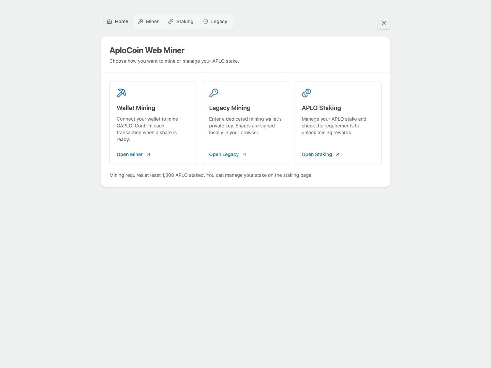

### Current wallet miner

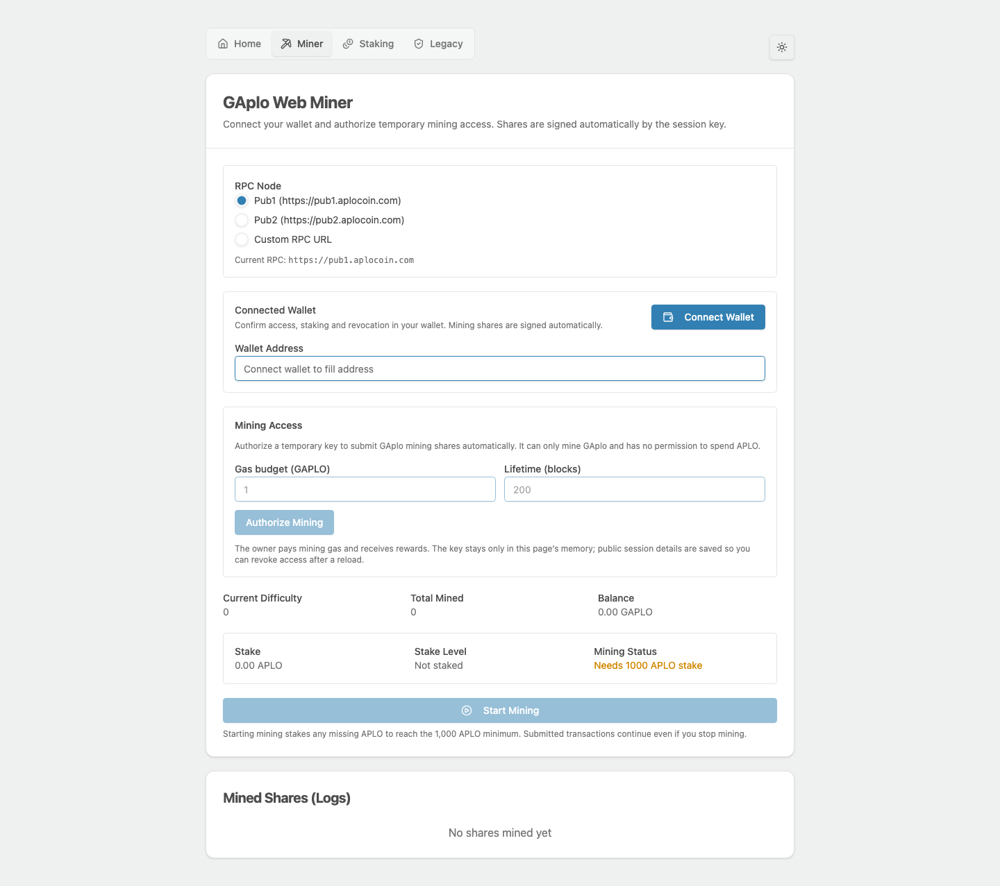

### Native access and a session-signed share (isolated devnet)

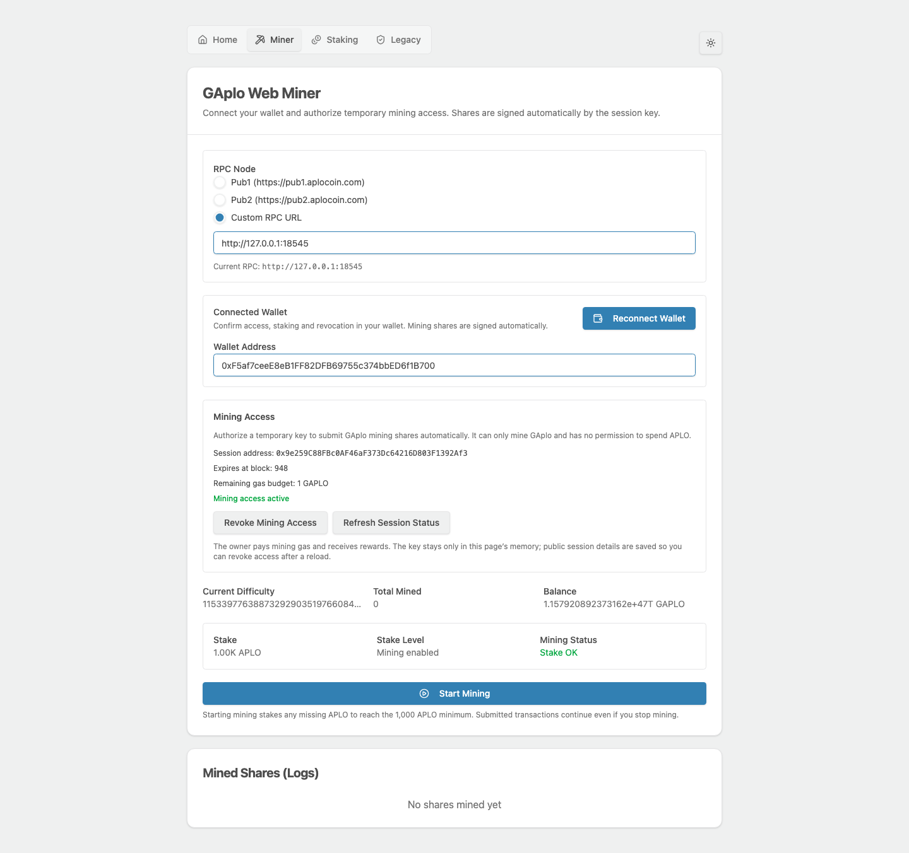
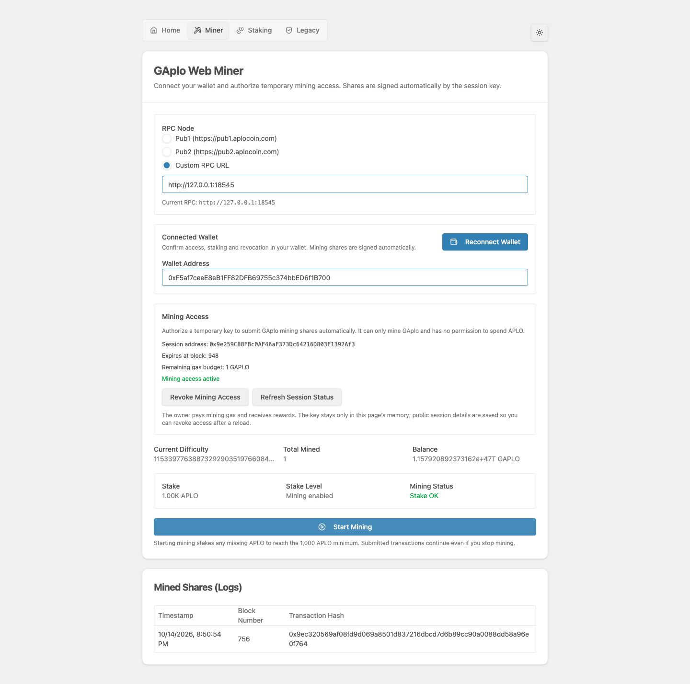

### Legacy private-key miner

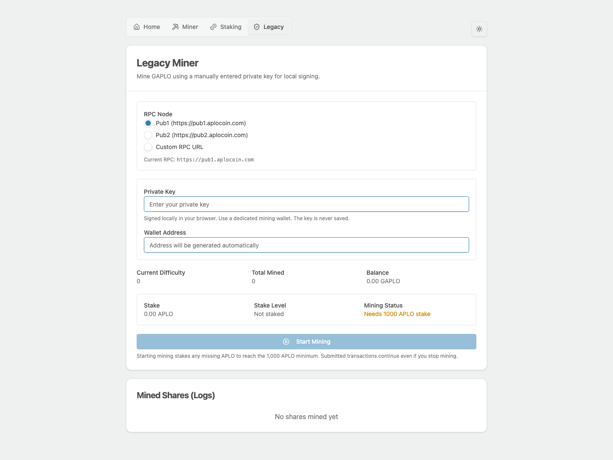

### APLO staking

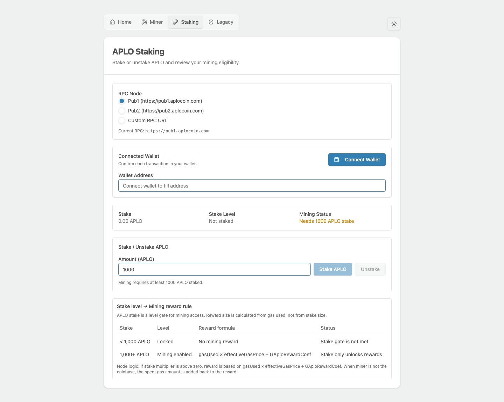

<details>
<summary>Mobile pages and dark theme</summary>

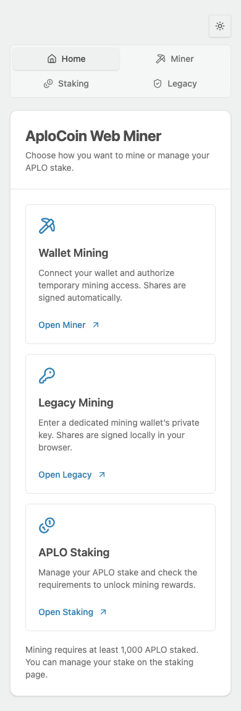
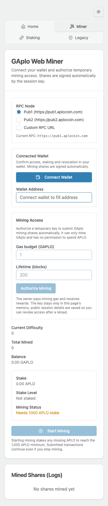
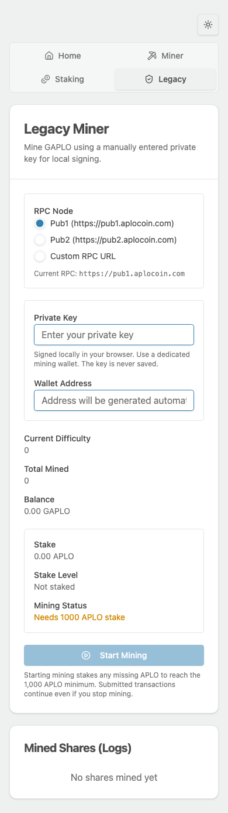
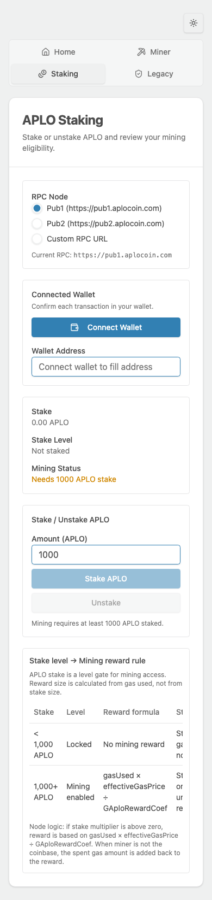
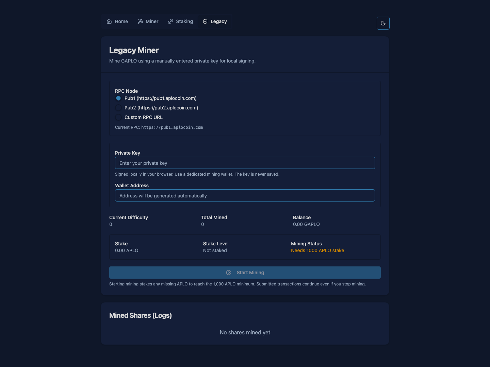
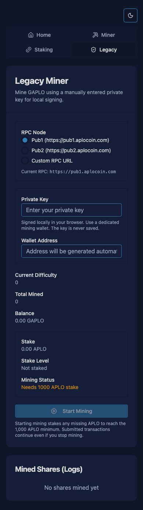

</details>

## RPC node configuration

Current and legacy mining reuse the saved RPC selection; staking uses the wallet provider:

| Option | URL |
| --- | --- |
| Pub1 | `https://pub1.aplocoin.com` |
| Pub2 | `https://pub2.aplocoin.com` |
| Custom RPC URL | A valid `http://` or `https://` endpoint |

The active endpoint appears under **Current RPC**. An invalid custom URL disables transaction controls instead of silently using the previous node. Mining node controls are locked during an active mining operation. Wallet mining requires the wallet network to match the selected RPC node. Staking uses the wallet provider directly (see below).

## Development and verification

The app requires Node.js 20+. The existing jsdom test dependency requires a supported Node.js 22.22.2+, 24.15+, or 26+ release.

```bash
npm ci
npm run dev
```

Open [localhost:3000](http://localhost:3000).

```bash
npm run typecheck
npm run lint
npm test
npm run build
npx playwright install chromium
npm run test:e2e
```

The build uses Next.js static export and writes `out/`. Browser tests serve this production output with `scripts/serve-export.mjs`, so build before running them. The default browser tests use synthetic accounts and intercepted RPC/wallet responses. The optional native devnet test registers a real session, computes a share with the same Web Worker, broadcasts its protected transaction to an isolated local AploNode, and revokes the session. See `docs/session-keys.md` for the devnet command and recorded receipts.

To refresh screenshots after building:

```bash
CAPTURE_SCREENSHOTS=1 npm run test:e2e
```

If the environment blocks Turbopack’s internal process/port, the supported alternative is `npm run build -- --webpack`.

## Security notes

- The legacy private key stays in component memory. It is not saved in browser storage or sent to the RPC node.
- Leaving the legacy page clears the key; use a dedicated mining wallet with limited funds.
- Session private keys stay only in page memory and are discarded on reload/navigation or a wallet/RPC change. Public session addresses, limits and registration hashes are saved by owner and chain so access can still be revoked after a reload.
- Selected RPC settings and the theme are also persisted.
- After reloading the current miner, reconnect the owner wallet, revoke the previous active session (or clear it after expiry), and authorize a fresh key.
- Both mining flows need sufficient balance for staking and gas.

## Contract addresses

- Mining: `0x0000000000000000000000000000000000001234`
- APLO staking: `0x0000000000000000000000000000000000001235`

## Troubleshooting

- Verify that the RPC node is reachable and matches the connected wallet’s network.
- Legacy keys must be valid 64-character hex keys, with or without `0x`.
- Ensure sufficient funds for transaction gas and at least 1,000 APLO stake.
- Mining waits for the existing 20-block cooldown between shares.
- If a transaction times out, check its hash on the selected chain before retrying.

### Wallet-driven staking

`/staking` connects directly to the injected EIP-1193 wallet. Its provider supplies
stake/balance reads, transaction submission, and receipt polling; saved miner RPC
settings do not affect this page. The active chain is checked at connection and
before sending. AploCoin mainnet is chain 28282 (`0x6e7a`, from AploNode's mainnet
configuration). On another chain, staking is disabled and **Switch to AploCoin**
requests an explicit wallet switch. An unknown-chain response (4902) offers the
configured AploCoin network through `wallet_addEthereumChain`, then requests the
switch and verifies it. Rejection/unsupported methods require manual selection.
Reconnect after switching, changing accounts, or disconnecting.

Mining and legacy keep their RPC selection. The wallet miner checks that its RPC
and wallet chains agree when connecting and sending. An account change cannot
select a new signer implicitly. Submitted staking transactions retain their
pending lock across context changes; a network/receipt error includes the
submitted hash and asks the user to check the original network before retrying.
Staking statistics do not request mining metadata.

`e2e/staking-wallet.spec.ts` covers provider-only reads, wrong chains, explicit
switch/add, wallet rejection, account/network/disconnect events, and pending
receipts. These browser tests use an EIP-1193 harness, not a real wallet extension.
